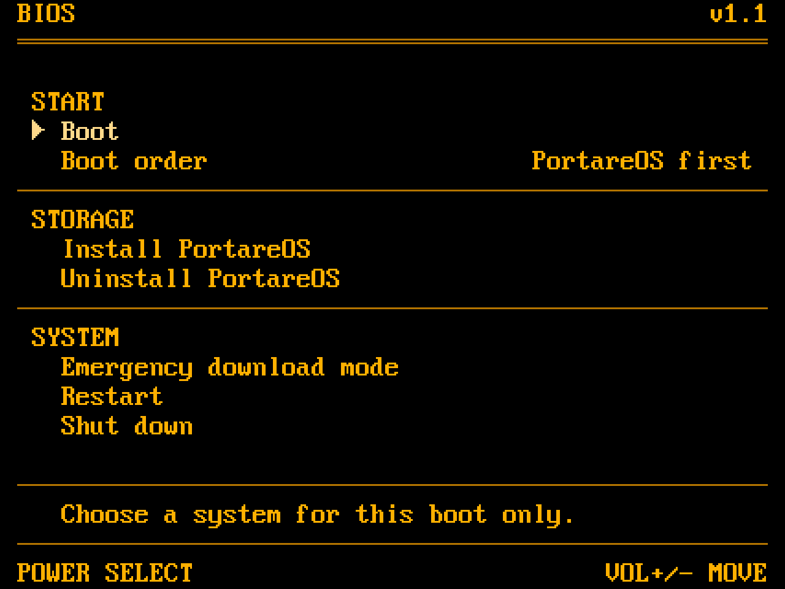
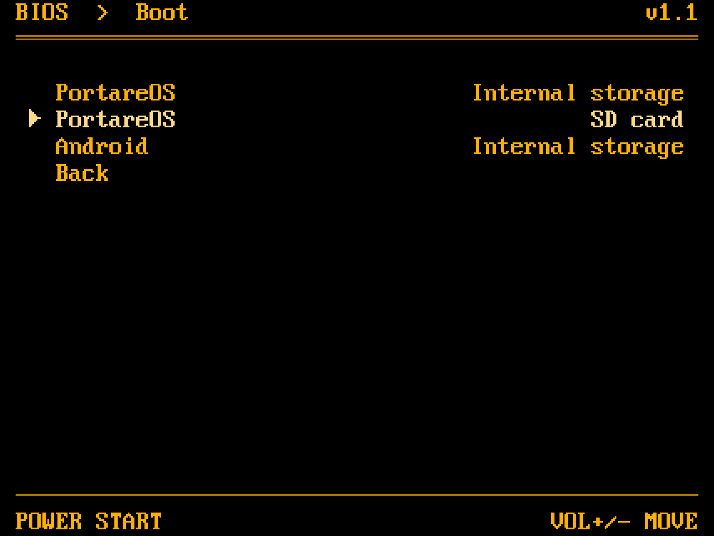

<picture>
  <source media="(prefers-color-scheme: dark)" srcset="Docs/logo-dark.png">
  
</picture>

Portare BIOS is a fork of OpenABL by the Open Handheld Collective:
Qualcomm's Android bootloader (ABL) with a graphical boot menu and standard
Linux boot. It is built for the Retroid Pocket Nova (SM8550), running
PortareOS and Android. The ABL patch and integration files are in `Abl/`;
the menu program is embedded in the firmware volume.

The build also supports SDM845, SM4450, SM6115, SM6450, SM7675, SM8250,
SM8650 and SM8750.

<p>
  
  
</p>

The main menu and the boot list, rendered by the simulator (`make sim`).

## Using it

For the Nova, use `abl_signed-SM8550.elf`. From fastboot, with ABL flashing
unlocked, write both slots:

```bash
fastboot flash abl_a abl_signed-SM8550.elf
fastboot flash abl_b abl_signed-SM8550.elf
fastboot reboot
```

Fastboot's `product` is `PortareBIOS`.

At power-on, unless a one-shot boot has been requested:

| Held | What happens |
|---|---|
| Nothing | Starts the saved default system: PortareOS/Linux by default, or Android. A failed boot opens the menu with an error. |
| Volume Down | Opens the menu, with fastboot available over USB. `fastboot reboot bootloader` also opens it; a keyboard's Delete key requests it too. |
| Volume Up | With PortareOS/Linux as the default, starts Android. With Android as the default, starts Android recovery. The stored `AltVolumeUp` setting can override this with external Linux boot. |

When off-mode charging is enabled and a charger switches the device on,
BIOS shows its charging screen, unless a one-shot choice is pending: the
battery and its percent, estimated from the voltage, then the display goes
off after 5 seconds and any key shows it again. Power starts the default
system, a volume key opens the menu, and unplugging the charger turns the
device off.

In the menu, Volume Up and Down move the selection and Power selects.
Keyboard arrows and Enter also work. Lists have a **Back** row.

| Item | What it does |
|---|---|
| Boot | Opens the boot list. Selecting a system requests a one-shot boot without changing the saved boot order. |
| Boot order | Switches between **PortareOS, Android** and **Android, PortareOS**. Shown when Android is available. |
| Install PortareOS | Copies PortareOS from a PortareOS SD card to internal storage, with nothing else booted. **Dualboot** keeps Android: a first install shrinks Android's data partition to a chosen size, which resets Android; with PortareOS already next to Android it only replaces PortareOS's system, keeping its games, saves and settings. **Replace Android** removes Android, and any PortareOS already there, and gives PortareOS all of internal storage. Each shows the resulting space before it asks to confirm. |
| Emergency download mode | Restarts into Qualcomm EDL mode, after confirmation. |
| Restart | Restarts normally, using the saved default. |
| Shut down | Powers off. |

Debug builds add a **Debug** section with display experiments and, where
supported, a USB host experiment.

**Boot order** chooses the default OS; it does not edit the UEFI
`BootOrder` variable. If the automatic boot fails, the menu opens.

The **Boot** list scans internal storage and the SD card regardless of the
saved boot source. It lists BLS entries, unified kernel images and extlinux
labels, then default EFI files, then each drive's first Android-format boot
image, followed by Android. Boot images on a volume labelled `PORTAREOS`
are named **PortareOS**; other boot images are named **Linux**. Rows show
internal storage or SD card.

A Linux choice is tied to its drive and consumed once. If the drive is
missing or the attempt fails, the menu reports the error without continuing
the normal cross-drive boot search. Android choices also apply once.
One-shot choices override the saved default and Volume Up decisions;
requests to enter fastboot still take priority.

## Settings and boot logo

The older settings menu is gone. Its **Boot mode** setting is now controlled
through **Boot order**. These other settings still affect the code, but
have no controls in the main menu or dedicated fastboot setters:

| Setting | Effect |
|---|---|
| `AblMode` | Silent or verbose ABL output. Verbose mode keeps the failed boot's log on screen until a key is pressed. |
| `AltVolumeUp` | Makes Volume Up start external Linux instead of Android or recovery. |
| `BootSource` | Restricts automatic Linux boot to Auto, Internal or SD card. Auto searches internal storage first; Internal falls back to SD when no internal Linux installation is detected. The Boot list ignores this restriction. |
| `DisplayRotation` | Automatic rotation, or 0, 90, 180 or 270 degrees. Automatic rotation uses model information and panel orientation. |
| `CustomLogo` | Enables the custom Linux boot splash. Off by default. |
| `DeviceModel` | Selects the model used to find Linux's devicetree. The model picker also opens from the "Device model isn't set" error screen. |

Settings use UEFI variables; SDM845 builds also persist them through
`devinfo`. Names and encodings are in `Core/Settings.h` and
`Core/Settings.c`; the vendor GUID is in `Efi/Variables.h`.

Off-mode charging remains available through fastboot:

```bash
fastboot oem off-mode-charge 1
```

Use `0` to disable it. `fastboot oem device-info` reports verification,
unlock and charger-screen flags; it does not provide the former menu's
full hardware information screen.

**Boot logo:** when `CustomLogo` is enabled, builds with `card-logo` read
uncompressed 24- or 32-bit BMPs from `\logo` on the first allowed drive with
usable pictures. Orient them as the device is held. A single picture is
centred on black; multiple pictures play once in name order, at 10 frames
per second or the rate in `\logo\fps` (1 to 60). The last frame stays on screen.
Without usable pictures, the splash shows the OpenABL wordmark.

## Boot methods

Supported boot storage is internal UFS/eMMC and the SD card. USB is for
fastboot and EDL.

Automatic Linux boot uses the allowed drives in these stages:

1. The standard boot manager: `BootNext`, `LoaderEntryOneShot`,
   `LoaderEntryDefault`, UEFI `BootOrder`, then discovered entries in drive
   order.
2. Default EFI boot files on the allowed drives.
3. The first usable Android-format boot image.

| Method | Where it looks |
|---|---|
| Boot Loader Specification Type #1 | `\loader\entries\*.conf` |
| Unified kernel images (Type #2) | `\EFI\Linux\*.efi` |
| extlinux | `\extlinux\extlinux.conf`, then `\boot\extlinux\extlinux.conf` |
| Default EFI loader | `\EFI\BOOT\BOOTAA64.EFI`, then `\EFI\BOOT\BOOTARM.EFI` |
| Android-format Linux boot image | `\KERNEL`, `\boot\Image`, `\kernel.img`, `\boot.img` |

BLS and extlinux kernels need an EFI stub. Gzip-compressed kernels are
decompressed before loading, and entry initrds are supplied through the
Linux EFI initrd protocol. BLS boot counters and Boot Loader Interface
variables are supported.

**Devicetrees:** an entry's valid `devicetree` or extlinux `FDT` takes
precedence. Otherwise, the selected model's tree is sought on that drive
in `\boot\grub`, `\dtbs`, `\dtbs\qcom`, `\dtb` or `\dtb\qcom`, then among
the boot image's appended trees. extlinux `FDTDIR` can also supply a
matching tree. With no selected model or entry tree, EFI boot retains the
firmware's tree. Devicetree overlays are not applied.

The Android-format Linux boot-image path supports headers v0 to v2 and
requires a saved model matching a devicetree appended to the kernel.
Headers v3 and later are not supported by this path. If the model is
unset, press a key on the error screen, select the device model, then retry.

For Linux boot images:

- `cmdline.txt` replaces the embedded command line. If no override is
  found, `cmdline-append.txt` adds to it. The first nonempty readable file
  of the chosen kind across mounted filesystems wins.
- When the source has a GPT partition GUID,
  `portare.bootpart=PARTUUID=<guid>` is appended after any file override,
  using a lowercase GUID. This lets the initramfs identify the installation
  the kernel came from when internal storage and SD have identical labels.
- A disk image written to `userdata` can expose its nested ESP for boot.
  The initramfs must map the nested root partition itself, for example
  with `losetup -P`, using `--sector-size 4096` for a 4096-byte-sector image.

Firmware handover publishes the ABL version through ESRT as
`major << 16 | minor`, and reports unavailable runtime services through
`EFI_RT_PROPERTIES_TABLE`. Linux UEFI-variable access uses
`qcom_qseecom_uefisecapp`; `Linux/` contains a `qcom_scm` allowlist patch
for several supported SoCs.

**Android** uses the device's own boot partitions and Qualcomm's boot
path, including verified boot and recovery.

## Building

Requires git, zip, and a running Docker engine or Apple's `container` on
a Mac. The build uses a `linux/amd64` container, including on Apple Silicon.
`build.sh` prefers Docker when it is running.

```bash
./build.sh sm8550
```

It builds for the Nova's chipset, SM8550; `all` means the same. Output
names retain OpenABL naming:

| Output | Contents |
|---|---|
| `build/out/abl_signed-SM8550.elf` | Signed ABL image, with a neighbouring `.sha256` file |
| `build/out/openabl-recovery-flashable-sm8550.zip` | Android recovery addon that flashes both ABL slots and installs an `addon.d` script to restore the opposite slot after compatible OTA updates |
| `build/abl-build.log` | Full build log |

`VERSION` holds `MAJOR.MINOR`, reported by the menu, fastboot's
`version-bootloader` and the Linux handover's ESRT.

| Option | Effect |
|---|---|
| `--no-standard-boot` | Omits the UEFI boot manager, BLS/UKI/extlinux discovery and Boot list population. Default EFI files and boot images remain available to automatic Linux boot. |
| `--debug` | Adds the Debug menu section and diagnostics |
| `--clean` | Builds from scratch |

`Scripts/fetch.sh` fetches pinned microui, qtestsign and Qualcomm edk2
sources into `build/`. The edk2 tag is
`KERNEL.PLATFORM.3.0.r23-02400-kernel.0`; the script applies
`Abl/openabl.patch` and copies `Abl/QcomModulePkg` into it. Later builds
reuse sources and build output.

To build only `build/menu/openabl-menu.efi` with local clang, lld-link,
make and Python 3:

```bash
Scripts/fetch.sh
make FEATURES=standard-boot,card-logo
```

`FEATURES` selects optional components; the Makefile documents them.
`build.sh` supplies the Nova's features automatically.

The host simulator needs a C compiler and zlib:

```bash
Scripts/fetch.sh microui
make sim
build/sim/openabl-menu-sim
```

It writes PNGs to `build/screens`. Use `--out DIR` or `--filter TEXT` to
control output, or `--check` to check redraw consistency.

GitHub Actions builds on `v*` tags and uploads two files to the release:
`abl_signed-SM8550.elf` and `openabl-recovery-flashable-sm8550.zip`.
GitHub shows each file's SHA-256.

Manual builds select a tag and release or debug mode. Debug files end in
`-debug` and go to a separate `debug-<TAG>` pre-release. CI caches fetched
sources in the `sources` pre-release, keyed by the pins in
`Scripts/fetch.sh`. Pull requests to `main` build in debug mode.

## Future direction

**Firmware updates** remain planned, not implemented. The proposed flow is:

1. Linux stages an ABL image and checksum in `\openabl\update\` on the boot
   drive, avoiding dependence on persistent UEFI-variable writes.
2. Before booting, BIOS validates the checksum, ELF and segment hashes,
   image size, target chipset, version and available power.
3. It writes and reads back the inactive ABL slot, then the active slot,
   retaining the checked image until the operation finishes.
4. Update results are recorded for ESRT's last-attempt fields.

A later in-memory trial boot could validate the new menu before writing.
fwupd integration would need a way to stage the files and read the result.

## Licence

GPL-3.0-or-later (`LICENSE`), with upstream OpenABL copyright
(C) 2026-present Open Handheld Collective.

`Abl/` adds permission to link with Qualcomm's ABL. The kernel patch in
`Linux/` is GPL-2.0-only. `LICENSES.md` explains the exceptions and lists
third-party components; licence texts are in `LICENSES/` and the font
licences are in `Assets/`.
