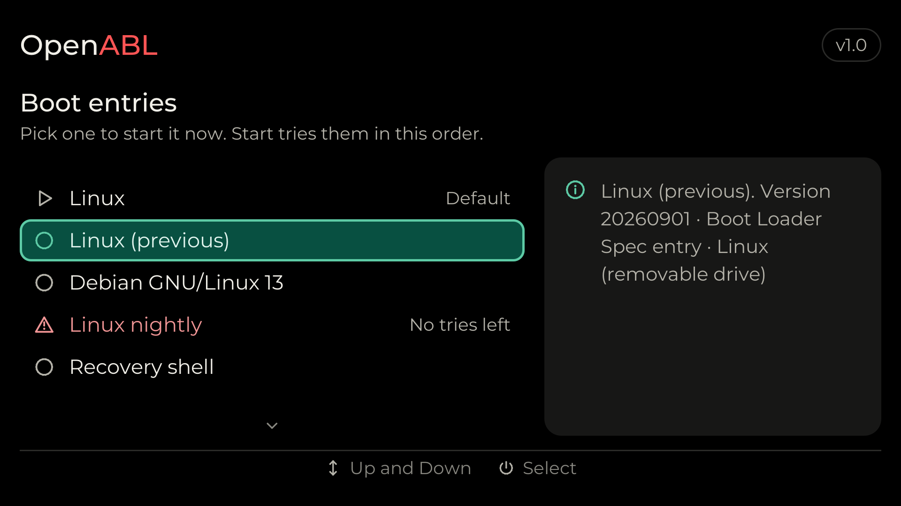

<picture>
  <source media="(prefers-color-scheme: dark)" srcset="Docs/logo-dark.png">
  
</picture>

A graphical boot menu and standard Linux boot for Qualcomm handhelds,
built into Qualcomm's Android bootloader (ABL). OpenABL is Qualcomm's ABL
with one patch and a few added files (`Abl/`). It carries the menu program
in its firmware volume and starts it instead of its own fastboot menu.

<p>
  
  
</p>

The main menu and the boot entries, rendered by the simulator (`make sim`).

Supported chipsets: SDM845, SM4450, SM6115, SM6450, SM7675, SM8250, SM8550,
SM8650 and SM8750.

## Using it

Flash the image for your chipset to the ABL partition (both slots on A/B
devices):

```bash
fastboot flash abl_a abl_signed-SM8550.elf
```

```bash
fastboot flash abl_b abl_signed-SM8550.elf
```

At power-on:

| Held | What happens |
|---|---|
| Nothing | Boots the selected *Boot mode* (Linux or Android) from the *Boot source*. If nothing boots, the menu opens and shows why. |
| Volume Down | Opens the menu. Fastboot still works over USB while it is open. `fastboot reboot bootloader` also opens it. |
| Volume Up | Boots Android when the boot mode is Linux, or Android recovery when it is Android. With *Volume up at boot* set to *Linux (external)*, boots Linux from the SD card or a USB drive instead. |

In the menu, Volume Up and Down move the selection and Power selects.

| Item | What it does |
|---|---|
| Start | Boots the current boot mode (*Start Linux* or *Start Android*). |
| Boot entries | Lists everything *Start* would try, in order: boot entries, then each drive's `\EFI\BOOT\BOOTAA64.EFI`. Picking one boots only that entry. Shown only when there is more than one. |
| Restart bootloader | Restarts into the menu. |
| Recovery mode | Restarts into Android recovery. |
| Emergency download mode | Restarts into Qualcomm EDL mode, after a confirmation. |
| Boot other slot | Switches to the other A/B slot. Shown on A/B devices. |
| Language | Opens the list of the menu's languages, each named in itself. |
| Boot mode | Linux or Android. |
| ABL mode | Silent, or Verbose to show the ABL's log on screen while booting. |
| Volume up at boot | Sets what holding Volume Up at power-on does. |
| Boot source | Auto (internal storage first), Internal, SD card or USB. |
| Off-mode charging | Shows the charger screen when plugged in while powered off. |
| Display rotation | Auto (from the device model) or fixed at 0, 90, 180 or 270 degrees. |
| Custom boot logo | Replaces the manufacturer's logo at boot with the pictures in a `\logo` folder (see below), or the OpenABL wordmark if there are none. Off by default. |
| Device model | Selects the devicetree Linux boots with, from the `.dtb` files in `\boot\grub`, `\dtbs`, `\dtbs\qcom`, `\dtb` or `\dtb\qcom` on the boot source's drives. A boot entry's own devicetree takes precedence. *Firmware default* uses the firmware's own. |
| Log | Shows the ABL's and the menu's log. |
| Device info | Shows the chip, platform, PMICs, memory, storage, panel and firmware versions. |
| Uninstall CFW | Removes a Linux install from internal storage, after a confirmation. Shown only when one is installed. |
| Power off | Shuts down. |

Settings are stored as UEFI variables and kept across restarts.

**Boot logo:** with *Custom boot logo* on, put uncompressed 24- or 32-bit
BMP files in a `\logo` folder on a drive the boot source can use, such as the SD card's boot
partition, oriented the way the device is held. A single BMP is shown
centred on black. Several BMPs play once as an animation in name order, at
10 frames per second or the rate given in a text file `\logo\fps` (1 to
60), and the last frame stays on screen.

## Boot methods

**Linux** is booted from the drives allowed by the boot source, in this
order:

1. `Boot####` options: `BootNext`, then `BootOrder`.
2. On each drive: Boot Loader Specification entries and unified kernel
   images, then extlinux.conf labels, then the default boot file.

| Method | Where it looks |
|---|---|
| Boot Loader Specification Type #1 entries | `\loader\entries\*.conf` |
| Unified kernel images (Type #2 entries) | `\EFI\Linux\*.efi` |
| extlinux.conf | `\extlinux\extlinux.conf`, `\boot\extlinux\extlinux.conf` |
| The default boot file (GRUB, systemd-boot or any EFI loader) | `\EFI\BOOT\BOOTAA64.EFI` |

- Kernels are started through their EFI stub (gzip-compressed kernels are
  decompressed first), with their initrds and either the entry's devicetree
  or the selected device model's.
- Before the OS starts, memory XBL no longer needs is handed to it: DRAM
  outside the SoC's carveouts, XBL's unused regions, the plain reserved
  parts of `UEFI_FD` and `FV_Region`, and the display region except the
  framebuffer still on screen.
- Boot counting (`name+3.conf`) follows
  [Automatic Boot Assessment](https://systemd.io/AUTOMATIC_BOOT_ASSESSMENT/),
  and the [Boot Loader Interface](https://systemd.io/BOOT_LOADER_INTERFACE/)
  variables are set. Linux reaches the UEFI variables only through its
  QSEECOM driver (`qcom_qseecom_uefisecapp`), which needs the SoC on
  `qcom_scm`'s allowlist; the kernel patch in `Linux/` adds OpenABL's
  chipsets.
- Linux finds the ABL's version in the ESRT:
  `/sys/firmware/efi/esrt/entries/entry0/fw_version` (major << 16 | minor).
- An `EFI_RT_PROPERTIES_TABLE` tells Linux which runtime services XBL
  lacks: `SetVirtualAddressMap` on SDM845, all of them on SM6115.
- The display: a `splash_region` (or `cont_splash_region`) in the kernel's
  devicetree keeps XBL's splash on screen and is pointed at its
  framebuffer, as Qualcomm's ABL does for Android. Without one the display
  is switched off before Linux, which brings it up from cold. Loaders that
  call `EFI_DT_FIXUP_PROTOCOL` (systemd-boot, GRUB 2.12 and later) get the
  same for the devicetree they load.
- Boot sources are internal storage (UFS or eMMC), the SD card and USB
  drives. For USB the port is switched to host mode.
- A disk image written to `userdata` boots too: its ESP is found
  automatically. Linux doesn't read a partition table inside a partition,
  so the initramfs must map the image's root itself (for example
  `losetup -P`, with `--sector-size 4096` for a 4096-byte image on UFS).

**Android** boots from the device's own boot partitions, the same way as
with Qualcomm's ABL, including verified boot and recovery.

## Building

Requires git and Docker. The build runs in an amd64 container, so on Apple
Silicon use Docker Desktop or OrbStack.

```bash
./build.sh sm8550
```

Give one or more chipsets, or `all`. Images are written to
`build/out/abl_signed-<CHIPSET>.elf` with a `.sha256` file next to each. The
build also writes `build/out/openabl-recovery-flashable-<chipset>.zip`: a
recovery-flashable Android addon that writes ABL to both slots and sets up a
persistence addon.d script to re-flash the opposite slot after an OTA update.

The full log is in `build/abl-build.log`. The version, MAJOR.MINOR, is in
`VERSION`; the menu, fastboot's `version-bootloader` and Linux's ESRT report
it.

| Option | |
|---|---|
| `--no-standard-boot` | Leave out standard boot (Linux then boots only from the default boot file) |
| `--debug` | Debug build, with a Debug section in the menu |
| `--clean` | Build each chipset from scratch |

The first build downloads Qualcomm's ABL source (tianocore edk2 from
CodeLinaro, tag `KERNEL.PLATFORM.3.0.r23-02400-kernel.0`), applies
`Abl/openabl.patch` and adds the files under `Abl/QcomModulePkg`, and
downloads microui and qtestsign, all into `build/`. The first build of a
chipset takes about ten minutes; later builds only recompile what changed.

To build only the menu program (`build/menu/openabl-menu.efi`) with your own
clang and lld-link, fetch the sources with `Scripts/fetch.sh` and run make.
`FEATURES` selects the options (see the Makefile):

```bash
make FEATURES=standard-boot,card-logo
```

**Languages:** the menu's strings live in `Ui/Lang/`, one file per language
(`En.c`, `ZhHans.c`), and the *Language* setting picks one at run time. To
add a language, copy `Ui/Lang/En.c` to a new file, translate it and add one
line to `Ui/Lang/Languages.h`; strings it leaves out show in English. The
simulator renders it with `--lang` and the language's code.

GitHub Actions (`.github/workflows/build.yml`) builds every chipset when a
`v*` tag is pushed and uploads the images to that tag's release, with
`openabl-<TAG>-source.tar.xz`: this repository and the sources it fetches,
which `./build.sh` builds without fetching them again. Run it by hand to
pick a tag and a release or debug build; a debug build goes to its own
`debug-<TAG>` pre-release, and its images end in `-debug.elf`. Each build
also uploads `openabl-<TAG>.tar.gz` (or `-debug.tar.gz`) with a folder per
chipset holding its image and `.sha256`; the Package workflow makes that
archive for an existing release. CI keeps the sources it fetches in the
`sources` pre-release and fetches them again only after a pin in
`Scripts/fetch.sh` changes.

## Future direction

**Firmware updates.** XBL starts the ABL in the active slot and never falls
back to the other slot, so an update must never write an image XBL would
reject. The plan:

1. Linux puts `abl_signed-<CHIPSET>.elf` and its `.sha256` in
   `\openabl\update\` on the boot drive. No UEFI variables are needed, which
   Linux can't write persistently on every chip.
2. At the next boot, before the menu, OpenABL checks the file: its SHA-256,
   the ELF and its segment hashes (what XBL checks), its size, the chip it
   was built for, a newer version unless forced, and enough battery or a
   charger.
3. It writes the inactive slot's `abl` and reads it back, then the active
   slot's. A failed write of the active slot is redone from the checked
   copy. The file is then removed and the device restarts.
4. The result goes in a UEFI variable, which the ESRT reports as
   `last_attempt_version` and `last_attempt_status`.
5. fwupd's UEFI capsule path needs `UpdateCapsule` or a persistent
   `OsIndications`, which XBL doesn't offer, so fwupd needs a small plugin
   for steps 1 and 4.

A safer step can come later: start the new ABL in memory first and write it
only once its menu comes up. A bad ABL can always be restored through EDL
(9008) with the device's flat build.

## Licence

GPL-3.0-or-later (`LICENSE`), Copyright (C) 2026-present Open Handheld
Collective. `Abl/` adds a permission to link with Qualcomm's ABL and the
kernel patch in `Linux/` is GPL-2.0-only; `LICENSES.md` says why and lists
the third-party components, whose licence texts are in `LICENSES/`.
